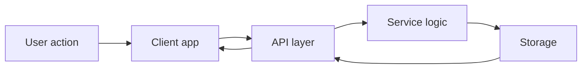

## Overview

Pau Vilar is organized as a starter documentation space that you can customize around your own product, team, or workflow. The goal is to help you understand the core building blocks first, then show how those pieces connect into a complete system.

This page uses generic architecture language on purpose. You can adapt the names, examples, and flows to match your own application without changing the overall structure.

<Callout kind="info">

This is a starter kit template. The examples below are realistic, but they are meant to be adapted to your own product and implementation details.

</Callout>

## Core Concepts

The system is easier to understand when you separate it into a few concepts:

<Columns cols={3}>
  <Card title="Interface" icon="monitor" href="#system-components">
    The visible layer where users interact with features, forms, and navigation.
  </Card>
  <Card title="Services" icon="settings" href="#system-components">
    The application logic that validates requests, applies rules, and coordinates work.
  </Card>
  <Card title="Data Layer" icon="database" href="#data-flow">
    Storage, caching, and retrieval systems that keep information available and consistent.
  </Card>
</Columns>

These concepts work together, but they remain intentionally separate so you can test, scale, and replace them with less risk. When you keep responsibilities clear, you reduce coupling and make the system easier to maintain.

## System Components

A typical implementation includes a small set of cooperating pieces.

<Columns cols={2}>
  <Card title="Client App" icon="code" href="#system-components">
    Handles the user interface, local state, and requests to backend services.
  </Card>
  <Card title="API Layer" icon="cloud" href="#system-components">
    Exposes endpoints, validates input, and returns structured responses.
  </Card>
  <Card title="Worker Process" icon="zap" href="#system-components">
    Runs background tasks such as retries, imports, and scheduled jobs.
  </Card>
  <Card title="Storage" icon="database" href="#system-components">
    Persists application data, logs, and operational records.
  </Card>
</Columns>

### Design Principles

You should design each component around a single job:

- Keep the interface focused on presentation.
- Keep services focused on rules and orchestration.
- Keep storage focused on durability and retrieval.
- Push expensive or delayed work into background tasks when possible.

<Callout kind="tip">

A good rule of thumb is to make the happy path simple, then isolate complexity behind clear boundaries.

</Callout>

## Data Flow

A clean data flow helps you understand what happens from user action to stored result.



When you read the flow from left to right, you can see how data moves through the system in stages:

1. The user performs an action in the interface.
2. The client app sends a request to the API.
3. The API validates the request and calls service logic.
4. The service layer reads or writes data.
5. The API returns a response that updates the interface.

## How the Pieces Fit Together

<Steps>
  <Step title="Collect input" icon="users">
    You start with user input, a form submission, or an event from another system.
  </Step>
  <Step title="Validate and route" icon="shield">
    The API checks the payload, enforces rules, and forwards work to the correct service.
  </Step>
  <Step title="Process and persist" icon="database">
    The service layer applies business logic and stores the result in a durable system.
  </Step>
  <Step title="Return a response" icon="check-circle">
    The system returns a stable response that the client can render or use for follow-up actions.
  </Step>
</Steps>

This sequence helps you reason about failures as well. If something breaks, you can trace the issue to a single stage instead of debugging the entire application at once.

## Implementation Patterns

Different teams often choose different tools, but the pattern stays the same. The examples below show a realistic split between frontend, backend, and data access layers.

<Tabs>
  <Tab title="Frontend" icon="monitor">
    ```typescript
    type ProjectSummary = {
      id: string;
      name: string;
      status: "draft" | "active" | "archived";
      updatedAt: string;
    };

    async function loadProjects(): Promise<ProjectSummary[]> {
      const response = await fetch("https://api.example.com/projects", {
        headers: {
          "Accept": "application/json"
        }
      });

      if (!response.ok) {
        throw new Error("Unable to load projects");
      }

      return response.json();
    }
    ```
  </Tab>
  <Tab title="Backend" icon="cloud">
    ```typescript
    import { z } from "zod";

    const projectSchema = z.object({
      name: z.string().min(1),
      status: z.enum(["draft", "active", "archived"])
    });

    export async function createProject(input: unknown) {
      const data = projectSchema.parse(input);

      return {
        id: crypto.randomUUID(),
        ...data,
        createdAt: new Date().toISOString()
      };
    }
    ```
  </Tab>
  <Tab title="Data" icon="database">
    ```sql
    CREATE TABLE projects (
      id UUID PRIMARY KEY,
      name TEXT NOT NULL,
      status TEXT NOT NULL CHECK (status IN ('draft', 'active', 'archived')),
      created_at TIMESTAMP NOT NULL DEFAULT NOW()
    );
    ```
  </Tab>
</Tabs>

These examples are intentionally simple, but they reflect a real production shape: validate early, keep data structures explicit, and return predictable results.

## Example Request Lifecycle

<CodeGroup tabs="TypeScript,cURL">
  ```typescript
  const response = await fetch("https://api.example.com/projects/7c1f1d3a", {
    method: "PATCH",
    headers: {
      "Content-Type": "application/json"
    },
    body: JSON.stringify({
      status: "active"
    })
  });

  const result = await response.json();
  console.log(result);
  ```

  ```bash
  curl -X PATCH "https://api.example.com/projects/7c1f1d3a" \
    -H "Content-Type: application/json" \
    -d '{"status":"active"}'
  ```
</CodeGroup>

The same lifecycle should produce the same outcome regardless of the client. That consistency makes the system easier to document, test, and extend.

## Best Practices

You will get the best results when you follow a few design habits:

- Keep responsibilities narrow and explicit.
- Prefer stable contracts between layers.
- Treat validation as part of the architecture, not an afterthought.
- Make background work observable with logs and status fields.
- Use naming that reflects domain meaning instead of implementation detail.

<Expandable title="When should you split a component?" default-open="false">
  
Split a component when it starts handling two different responsibilities, needs separate scaling, or becomes difficult to test in isolation. If one piece changes for UI reasons and another changes for business reasons, you probably want two components.

</Expandable>

<Expandable title="How do you know the flow is too complex?" default-open="false">
  
If you cannot explain the request path in a few steps, the architecture is likely doing too much in one place. Refactor toward smaller services, clearer boundaries, and more explicit data contracts.

</Expandable>

## Summary

The main idea is simple: users interact with the interface, the system validates and processes work through services, and data persists in reliable storage. If you keep those boundaries clear, you can customize the documentation to fit your own product while preserving a structure that is easy to understand and maintain.